# Atlas Quest Router

Atlas Quest Router is a **step-by-step quest guide addon for World of Warcraft Forever**, written in Lua.
It reads the quests in your quest log and shows them one step at a time in a guide window: what to do now
(accept, kill, collect, turn in, or travel), an arrow pointing to where it happens, and what comes next.
The guide moves on by itself when you accept a quest, finish its objectives, turn it in or arrive at a place.

The order of the steps and the way you travel between them (walking, flight masters, boats, zeppelins,
the Deeprun Tram, class teleports, the hearthstone) are planned with the **ATLAS algorithm**
(Kabaca, Samir and Takan; original implementation: [savastakan/atlas](https://github.com/savastakan/atlas)).
ATLAS is the only routing algorithm in the project.

**Authors:** Qunoo A K Taweel (23291712, [Qanoo-Taweel](https://github.com/Qanoo-Taweel)) · Zeynep Arıcan (24290319, [zynparcn](https://github.com/zynparcn))

**Website:** <https://qanoo-taweel.github.io/wow-atlas-quest-router/> (live route planner, ATLAS explained step by step, diagrams)

| | |
|---|---|
| Language | Lua 5.1 (the Lua version inside the WoW client) |
| Addon | 33 Lua files, one class per responsibility |
| Design | SOLID principles and 11 named design patterns: Facade, Factory Method, Chain of Responsibility, Command, Builder, Strategy, Composite, Observer, Adapter, Repository, Value Object |
| Tests | 56 Lua tests and 5 website parity checks, run automatically on every push |
| Verified | The Lua version of ATLAS produces exactly the same output as the original `Atlas.java` on 7 test graphs (6 to 1,000 edges) |

---

## Contents

1. [Install and use](#1-install-and-use)
2. [Repository layout](#2-repository-layout)
3. [How it works, step by step](#3-how-it-works-step-by-step)
4. [ATLAS in detail](#4-atlas-in-detail)
5. [Software design: SOLID and patterns](#5-software-design-solid-and-patterns)
6. [Diagrams](#6-diagrams)
7. [Tests and verification](#7-tests-and-verification)
8. [The website](#8-the-website)
9. [Limitations](#9-limitations)
10. [Authors and credits](#10-authors-and-credits)

---

## 1. Install and use

1. Download this repository (green **Code** button → *Download ZIP*) and unzip it. You get a folder
   `wow-atlas-quest-router-main`; the addon is the folder **`AtlasQuestRouter`** inside it (the one with
   `AtlasQuestRouter.toc` in it). Copy that inner folder, not the outer one.
2. Find the game's AddOns folder. In the Battle.net app pick the game, click the ⚙ next to *Play* and choose
   *Show in Finder* (Mac) or *Show in Explorer* (Windows). Open the game's version folder (for example
   `_classic_era_`), then `Interface`, then `AddOns`. If `Interface` or `AddOns` does not exist yet, create it;
   the game only makes it after the first addon is installed.
   * Mac: `/Applications/World of Warcraft/<game folder>/Interface/AddOns/`
   * Windows: `C:\Program Files (x86)\World of Warcraft\<game folder>\Interface\AddOns\`

   Paste `AtlasQuestRouter` there, so the path ends in `.../Interface/AddOns/AtlasQuestRouter/AtlasQuestRouter.toc`.
   Restart the game if it was open.
3. In game, type `/dump select(4, GetBuildInfo())`. If the number is not `11507`, write it on the
   `## Interface:` line of `AtlasQuestRouter/AtlasQuestRouter.toc`.
4. Enable **Atlas Quest Router** in the *AddOns* menu on the character select screen.
5. Type `/aqr import` (reads your quest log) or `/aqr demo`, then `/aqr plan`. The guide window opens with the first step.

| Command | What it does |
|---|---|
| `/aqr help` | list every command |
| `/aqr import` | track the known quests that are in your quest log |
| `/aqr add <id or name>` / `/aqr remove <id>` | track / untrack one quest |
| `/aqr list` / `/aqr clear` | show / forget tracked quests |
| `/aqr plan` | compute the ATLAS route from where you stand |
| `/aqr next` / `/aqr back` | move the guide one step forward / back (normally it moves by itself) |
| `/aqr show` / `/aqr hide` | the guide window (also has *Back*, *Skip* and *Re-plan* buttons) |
| `/aqr from <place>` | plan from another place (`/aqr from here` to reset) |
| `/aqr speed foot\|60\|100` | your ground speed |
| `/aqr hearth <place>` | where your hearthstone is bound (read from the game when possible) |

Faction, class, level, hearthstone location and cooldown are read from the game. Tracked quests and settings are saved
between sessions (`SavedVariables: AtlasQuestRouterDB`).

## 2. Repository layout

```
AtlasQuestRouter/                  <- the addon (copy this folder into Interface/AddOns)
  AtlasQuestRouter.toc             load order + metadata
  AtlasQuestRouter.lua             FACADE + bootstrap (events, slash commands)
  Core/      Class.lua             classes, interfaces, abstract methods for Lua
             EventBus.lua          OBSERVER
  Graph/     Graph.lua             directed multigraph + Edge (port of Graph.java / Edge.java)
  Atlas/     AtlasSolver.lua       ATLAS Algorithm 1, weighted, with precedence
             AtlasClassic.lua      line-by-line port of Atlas.java (proof of understanding)
             AtlasSolverFactory.lua FACTORY METHOD for solver profiles
             LocalDag.lua          iterative DFS -> local DAG (paper 3.1, 3.2)
             LazyArray.lua         lazy array reset (paper 3.4)
             DistanceMatrix.lua    APSP precomputation used by the score (paper 3.4)
             ScoreComponents.lua   the 6 terms of eq. (1)            STRATEGY
             EdgeScorer.lua        sum of the terms + adaptive weights COMPOSITE
             DfsOrderings.lua      DFS visiting orders                STRATEGY
  Domain/    Quest.lua, QuestLog.lua (REPOSITORY), RequirementSet.lua, RoutePlan.lua (VALUE OBJECT)
  Data/      WorldData.lua         80 places, flight paths, boats, zeppelins, tram, teleports
             QuestData.lua         31 quests (Alliance, Horde, neutral), with quest chains
  Travel/    TravelLinks.lua       Walk, Flight, Boat, Zeppelin, Tram, Teleport, Hearthstone
             TravelLinkFactory.lua FACTORY METHOD
             AccessRules.lua       CHAIN OF RESPONSIBILITY (faction -> class -> level -> cooldown)
  Routing/   WorldGraphBuilder.lua BUILDER
             QuestRoutePlanner.lua application service (quests -> RoutePlan)
             EdgeGate.lua          one-use edges (hearthstone)
             LocationResolver.lua  game zone names -> map places
  Platform/  GameApi.lua           ADAPTER over the WoW API (+ a stub for tests)
             GameEventBridge.lua   ADAPTER: WoW quest/zone events -> guide moves on by itself
             Scheduler.lua         run ATLAS one iteration per frame (coroutine)
  UI/        UserInteraction.lua   chat / guide / headless outputs
             UserInteractionFactory.lua FACTORY METHOD (GoF form, abstract creator)
             GuideFrame.lua        the step-by-step guide window with direction arrow
             Commands.lua          COMMAND + CHAIN OF RESPONSIBILITY for /aqr
docs/                              the website (GitHub Pages) + diagrams + notes
  index.html, assets/              site; assets/atlas.js = JavaScript port of the planner
  diagrams/                        Mermaid sources (.mmd) + SVG + PNG for printing
  PATTERNS.md                      design patterns, where and why
  SIMPLIFIED_CLASS_DIAGRAM.md      the 12 central classes on one page
tests/                             Lua tests, Java fixtures, JS parity test
tools/                             fixture + website data generators
```

## 3. How it works, step by step

**Step 1. The world becomes a graph.** Every place (town, flight master, quest area) is a node.
`WorldGraphBuilder` adds edges for every way to travel, each weighted in **seconds**:

| Edge | Time model |
|---|---|
| walk | 3 nearest places on the same landmass + hand-made roads; distance × 1.3 (roads bend) ÷ your speed |
| flight | 5 s boarding + distance × 1.15 ÷ 32 yd/s; only your faction's flight paths |
| boat, zeppelin, tram | ride time + half the departure interval (expected wait) |
| teleport | 10 s cast, mages to their capitals, druids to Moonglade |
| hearthstone | 10 s cast to your bind point, usable once per plan, skipped if on cooldown |

Each candidate link is created by `TravelLinkFactory` and must pass the `AccessRule` chain
(faction → class → level → cooldown) before it becomes an edge.

**Step 2. Quest steps become required edges.** ATLAS covers *edges*, so every quest step (accept, objective, turn in)
is a **self-loop edge** at its place, weighted with the time the step takes. These are the required set **R**.
Precedence is attached: objectives need the accept, the turn-in needs all objectives, and a chained quest's accept
needs the previous quest's turn-in.

**Step 3. ATLAS covers R.** Starting from a zero-cost "start" loop where you stand, ATLAS repeats
(see [section 4](#4-atlas-in-detail)): local DAG → longest-path DP → best chain → append → mark served steps,
until every step is done (or reported unreachable, for example Teldrassil for a Horde character).

**Step 4. The tour becomes a guide.** `QuestRoutePlanner` turns the edge sequence into steps
("Fly to Sentinel Hill", "Accept 'Westfall Stew'"), merging consecutive walking and flying edges.
The guide window (`UI/GuideFrame.lua`) shows the current step in large text with an icon, an arrow that points
toward the destination (it turns as the player turns), a progress bar and the next steps.

**Step 5. The guide follows the game.** `Platform/GameEventBridge.lua` listens to the client:
accepting the quest (`QUEST_ACCEPTED`), completing its objectives (`QUEST_LOG_UPDATE`), turning it in
(`QUEST_TURNED_IN`) or entering the destination (`ZONE_CHANGED`) moves the guide to the next step and ticks it off.
*Skip* and *Back* are there for manual control.

**Step 6. The game never freezes.** In the client, ATLAS runs inside a coroutine and the `FrameScheduler` resumes it
once per rendered frame, so a long plan is spread over a few frames.

## 4. ATLAS in detail

ATLAS (2020) was designed to traverse **all edges of a graph at low cost** (test sequences for finite state machines).
The 2025 paper benchmarks it as a real-time arc-routing heuristic. Its core is **Algorithm 1, Longest Path Extension**:

```
T <- [start edge]
while R is not empty:
    v   <- last edge of T
    DAG <- topological order of the edges reachable from v (DFS, back edges removed)
    pathLong[v] <- 0, cost[v] <- 0
    for each edge e in DAG order, for each successor n of e:
        if pathLong[e] + value(n) is better than pathLong[n]:
            pathLong[n], cost[n], comeFrom[n] <- ...
    best <- argmax(pathLong[e] + score[e])
    backtrack comeFrom from best, append to T, remove served edges from R
return T
```

| Paper element | Where in the code |
|---|---|
| Iterative local DAG (3.1) | `Atlas/LocalDag.lua` (reverse post-order; back edges skipped by position) |
| Explicit-stack DFS instead of recursion (3.2) | `Atlas/LocalDag.lua` |
| Longest-path DP + backtracking (Alg. 1) | `Atlas/AtlasSolver.lua: extend()` |
| Cost penalty `Path_Score = utility − weight` (3.4) | `AtlasSolver` (`requiredValue`, `costPenalty`) |
| Multi-heuristic score, eq. (1)–(3) | `Atlas/ScoreComponents.lua`, `Atlas/EdgeScorer.lua` |
| Adaptive weights `_compute_adaptive_weights()` | `EdgeScorer:adaptTo(graph)` |
| Lazy array reset (3.4) | `Atlas/LazyArray.lua` |
| APSP precomputation (3.4) | `Atlas/DistanceMatrix.lua` (feeds the Savings/Proximity terms only) |
| Safety limit 100·\|E\| (3.4) | `AtlasSolver.safetyFactor` |
| Complexity O(\|R\|·(\|V\|+\|E\|)) | one DFS + one DP per iteration (× 4 DFS orderings) |

**What the addon adds for a game world** (all of it still ATLAS, no second algorithm):

* **Weights and precedence.** `value(n)` is `requiredValue` only when the quest step is *available* now.
* **Multi-DAG sampling.** Which edges become back edges depends on the DFS order. Each iteration runs the same
  DFS + DP with 4 orderings (cheapest first, required first, insertion, most expensive first) and keeps the best chain.
* **One-use edges.** `EdgeGate` closes all hearthstone edges after the first one is walked; within one DP pass a path
  may also use it at most once.
* **Tuning.** `requiredValue = 150` was chosen by planning 12 random quest logs with values from 50 to 100,000:
  small values make ATLAS cost-aware (best total time), very large values make it chase long chains of steps
  (2020 behaviour, up to ~85% slower routes on this map).

## 5. Software design: SOLID and patterns

Every file starts with a comment that says what it is for and which pattern it uses, and why.
The full discussion with "why" for each pattern is in [docs/PATTERNS.md](docs/PATTERNS.md).

| Pattern | Where | Why it is used |
|---|---|---|
| **Facade** | `AtlasQuestRouter.lua` | One simple API (`addQuest`, `plan`, `nextLeg`...) in front of ~15 classes; commands, buttons, events and tests only talk to it. |
| **Factory Method** | `UI/UserInteractionFactory.lua` | Abstract creator with `createInteraction(kind)`; the WoW factory makes a chat printer + the guide window, the headless factory makes recorders for tests. The facade does not change. |
| **Factory Method** | `Travel/TravelLinkFactory.lua`, `Atlas/AtlasSolverFactory.lua` | Callers ask for "boat" or the "quest" profile and receive a ready object; new kinds register without editing callers. |
| **Chain of Responsibility** | `Travel/AccessRules.lua` | Faction → Class → Level → Cooldown rules; each rejects or passes on. A new restriction is one class. |
| **Command + Chain of Responsibility** | `UI/Commands.lua` | Each `/aqr` verb is a command object; the request travels the chain until one handles it. |
| **Builder** | `Routing/WorldGraphBuilder.lua` | The routing graph is built in named, separately testable steps. |
| **Strategy** | `Atlas/DfsOrderings.lua`, `Atlas/ScoreComponents.lua` | Interchangeable DFS orders and scoring terms. |
| **Composite** | `Atlas/EdgeScorer.lua` | A scorer made of scorers; ATLAS asks one object. |
| **Observer** | `Core/EventBus.lua`, `Domain/QuestLog.lua` | The quest log publishes events; the facade drops stale plans. |
| **Adapter** | `Platform/GameApi.lua`, `Platform/GameEventBridge.lua` | The only files that talk to the WoW client (functions and events); everything else is testable outside the game. |
| **Repository** | `Domain/QuestLog.lua` | Stores tracked quests and (de)serialises them for SavedVariables. |
| **Value Object** | `Domain/RoutePlan.lua`, `Edge` | Plain result data, easy to render anywhere. |

| SOLID | How it shows |
|---|---|
| **S**ingle responsibility | Graph stores topology, AtlasSolver routes, WorldGraphBuilder builds, LocationResolver matches names, GuideInteraction draws. |
| **O**pen/closed | New travel mode, access rule, score term or command = a new class; nothing existing is edited. |
| **L**iskov substitution | Any `TravelLink`, `AccessRule`, `UserInteraction`, `IDfsOrdering` replaces another; tests swap `WowGameApi` for `StubGameApi`. |
| **I**nterface segregation | `IScoreComponent` (1 method), `IScheduler` (1), `IRequirementSet` (5). ATLAS never sees the quest model. |
| **D**ependency inversion | The facade receives `IGameApi`, `IScheduler`, `UserInteractionFactory`, planner through its constructor. `Class.implements` checks the interfaces at load time. |

## 6. Diagrams

All diagrams are Mermaid sources in [`docs/diagrams/`](docs/diagrams), rendered to SVG (screen) and PNG (printing).

| Diagram | Files |
|---|---|
| **All diagrams, print-ready (A4, one package per page)** | [`AtlasQuestRouter-diagrams.pdf`](docs/diagrams/AtlasQuestRouter-diagrams.pdf) · rebuild with `python3 tools/make_print_pdf.py` |
| Full class diagram (every class, attribute, method, relation) | [`class-diagram-full.svg`](docs/diagrams/class-diagram-full.svg) · [png](docs/diagrams/class-diagram-full.png) |
| Simplified class diagram (12 central classes with their methods) | [`class-diagram-simplified.svg`](docs/diagrams/class-diagram-simplified.svg) · [png](docs/diagrams/class-diagram-simplified.png) |
| Sequence diagram of `/aqr plan` | [`sequence-plan.svg`](docs/diagrams/sequence-plan.svg) |
| Layers / packages | [`packages.svg`](docs/diagrams/packages.svg) |
| ATLAS flowchart | [`atlas-flow.svg`](docs/diagrams/atlas-flow.svg) |



A one-page text version of the simplified diagram: [docs/SIMPLIFIED_CLASS_DIAGRAM.md](docs/SIMPLIFIED_CLASS_DIAGRAM.md).

## 7. Tests and verification

```bash
lua5.1 tests/run.lua            # 56 tests: core, ATLAS, patterns, planner, guide, facade
node tests/parity.mjs           # website JS planner == Lua addon, 5 scenarios
tools/java_reference.sh         # (optional) re-create Java fixtures with the original Atlas.java
lua5.1 tools/export_web_data.lua # re-export website data after changing Data/*.lua
```

* **Faithful to the original.** `tests/spec_atlas_classic.lua` runs `AtlasClassic` on `bbtas` and six generated FSMs
  (up to 100 states × 10 inputs = 1,000 edges) and compares the output with what the real `Atlas.java` printed
  (`tests/fixtures/*.java.txt`, made by `tools/java_reference.sh`). All 7 are identical, character for character.
* **Planner properties.** Every step is covered, the order respects accept → objectives → turn in and quest chains,
  legs form a continuous journey, the hearthstone is used at most once, unreachable steps are reported, a 24-step plan
  takes well under 2 s in plain Lua 5.1.
* **Guide behaviour.** Accepting, finishing, turning in and arriving move the guide on; unrelated events do not;
  the guide window renders with a simulated frame API.
* **Patterns tested by behaviour.** Chains stop at the right rule, factories return the right subclass, the
  abstract creator refuses to create, the adapter reads a fake WoW environment.
* **Website = addon.** `tests/parity.mjs` checks that the JavaScript planner gives the same tour, legs, total time
  and iteration count as the Lua addon.
* **CI.** `.github/workflows/ci.yml` runs all of the above on every push.

## 8. The website

**Open it here:** <https://qanoo-taweel.github.io/wow-atlas-quest-router/>

The website is in the `docs/` folder and is published by GitHub Pages. It has:

* **Live planner.** Choose faction, class, riding speed, starting place, hearthstone and quests; ATLAS computes the
  route in the browser and draws it on a map of both continents (one colour per travel mode), with the numbered steps,
  timings and an animated traveller.
* **The guide window.** A live preview of the in-game guide.
* **ATLAS step by step.** A small example map; each iteration shows the order of the local DAG, the dynamic
  programming table (utility, cost, score, predecessor) and the chosen chain.
* **Architecture and diagrams.** The design patterns, the SOLID table and all diagrams with PNG downloads.

The website runs the same planner as the addon (a JavaScript copy of the Lua code, checked by `tests/parity.mjs`
to give exactly the same routes).

To open it without internet access, download the repository and open `docs/index.html` in a browser.

## 9. Limitations

* The `.toc` interface number may need updating for your client build (see install step 3).
* The direction arrow uses our overview map, so it shows the general direction, not an exact waypoint.
* Map positions and travel times are approximations made for routing, on our own overview map.
* The quest catalogue is a sample of 31 quests; `/aqr import` only recognises quests that are in `Data/QuestData.lua`.
* ATLAS is a heuristic. It is fast and good, not guaranteed optimal; the paper reports a 20–30% gap to the best known
  solutions on small benchmarks, traded for millisecond response time.

## 10. Authors and credits

* **Qunoo A K Taweel**, GitHub [Qanoo-Taweel](https://github.com/Qanoo-Taweel)
* **Zeynep Arıcan**, GitHub [zynparcn](https://github.com/zynparcn)


* ATLAS: H. Kabaca, A. Samir, S. Takan, *Benchmarking Atlas: A High-Performance Heuristic for Large-Scale Arc Routing
  Problems* (preprint, SSRN 6099031); original Java implementation [savastakan/atlas](https://github.com/savastakan/atlas).
* `tests/fixtures/bbtas.fsm` is the `bbtas` benchmark machine shipped with savastakan/atlas.
* World of Warcraft is a trademark of Blizzard Entertainment.

License: MIT (see [LICENSE](LICENSE)).
